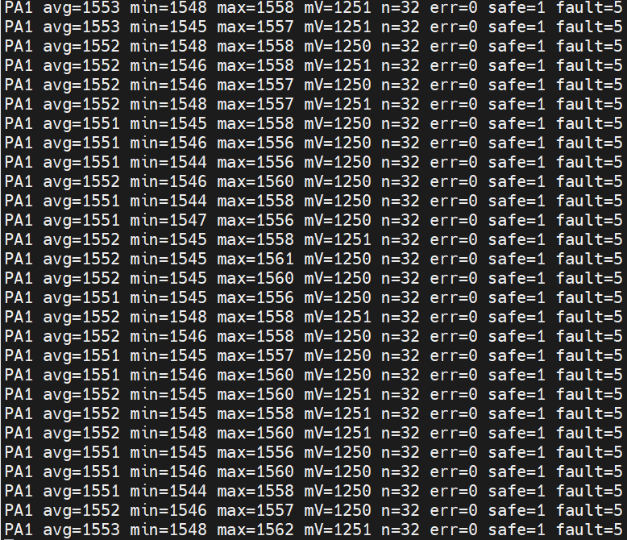

# PA1 原始 ADC 观察测试记录

日期：2026-10-17。固件基于 `153e2b0` 增加 `ADC_RAW_TEST_MODE=1`；源码与本记录在同一提交归档。

## 结论

**PA1 原始 ADC 采样与串口观察的基础功能验证通过。电压准确度、正式零点和电流标定尚未通过验证，真实 PI 闭环未启用。**

用户在完成分压接入后，按无电流观察步骤提供了串口截图。截图中可见 28 组输出，每组 32 次有效采样、错误数为零。截图未包含同步负载电流、万用表电压、实际参考电压或时间戳，因此不能仅凭截图独立确认电流为零、刷新周期或长期稳定性。

## 硬件与固件条件

- 主控：NUCLEO-F446RE；传感器：HW-525 / ACS758LCB-050B。
- 供电沿用已验证的分离方案：USB 给开发板供电，开发板 5 V/GND 给传感器供电；台式电源用于 IP+/IP− 和 20 Ω / 50 W 电阻的独立负载回路。
- 本次操作要求：负载电源关闭，PA1 原电位器滑动端移除，PWM 不接功率级。
- OUT2 缓冲输出的判断仍是资料与连通性推断，未完整追踪原理图。
- 接口标称值：R1=10 kΩ、R2=10 kΩ、R3=1 kΩ、C1=100 nF。

```text
OUT2 ---- R1 ---- A ---- R3 ---- B ---- PA1
                 |             |
                 R2            C1
                 |             |
GND -------------+-------------+------ 开发板 GND
```

R1/R2 在电路中测得约 8.884 kΩ，取出后用户报告 10.0013 kΩ，尚未分别对应两只电阻；R3 在电路中报告约 1.0077 kΩ。正式换算前还需分别确认 R1/R2 的独立阻值，不能把受并联路径影响的读数当作实际阻值。

观察模式在 ADC 初始化的 USER CODE 区改为单通道 PA1，12 位、84 周期采样、软件触发、轮询读取；原 `.ioc` 双通道配置保留。每约 250 ms 连续采集 32 次，经 USART2 115200/8N1 输出统计值。该周期是代码设定，截图未单独验证实际周期。

`mV` 按暂定 `ADC_TEST_VREF_MV=3300` 计算，表示 PA1 端电压，尚未还原分压前电压，也未换算电流。平均原始值和毫伏值分别由采样总和计算并取整，因此相同整数 `avg` 可能对应相邻的整数 `mV`。

四路 PWM 在代码中保持零占空比，功率指令不能改变 PWM；PI 和 `0x200` 测量反馈暂停。心跳接收、超时故障码 5 及手动复位恢复的锁存逻辑保留。`ADC_RAW_TEST_MODE=0` 只恢复旧电位器台架模式，不代表已支持 ACS758 真实电流控制。

## 原始证据与转录



[逐行转录 CSV](data/2026-10-17-pa1-adc-raw.csv) 来自上图，按从上到下编号。它是 28 行统计输出，**不是 896 点逐点原始数据**；原图保留用于复核。截图不包含启动横幅及超时发生瞬间。

| 指标 | 截图统计 | 可支持的判断 |
|---|---|---|
| 可见输出组数 | 28 | 仅代表本截图片段 |
| 有效采样数 | 每组 32，合计报告 896 次 | 这些组均完成预定次数 |
| `err` | 全部为 0 | 此片段未报告 ADC 启动、轮询或停止错误 |
| `avg` | 1551～1553 | 组平均值变化范围为 2 个码值 |
| `mV` | 1250～1251 mV | 基于假定 3.300 V 参考电压的估算 |
| 所有组的最低/最高单次值 | 1544 / 1562 | 跨组总范围 18 个码值 |
| 单组 `max-min` | 9～16 个码值 | 原始采样存在可见波动 |
| `safe / fault` | 全部 1 / 5 | 与心跳超时故障状态一致，故障状态下采样继续 |

以 3.300 V/4095 换算，组平均值范围约对应 1.61 mV，单次值的跨组总范围约对应 14.51 mV。这些是该片段的峰峰范围，不能当作 RMS 噪声、精度或完整量程指标。

`safe=1 fault=5` 本身不能证明超时响应时间、硬件 PWM 电平或恢复后锁存行为；本轮没有新增这些项目的示波器或复位测试证据。

## 与万用表记录的关系

接入 PA1 时用户报告 1.2377 V，本次串口估算为 1.250～1.251 V，相差约 12.3～13.3 mV。两者不是同步读数，实际 VDDA/VREF+ 也未提供，不能将差值直接认定为 ADC 误差，更不能据此修改增益或固定零点。

较早的分压静态复核记录为 VCC=4.973 V、OUT2=2.495 V、B=1.2453 V；这些同样不是当前截图的同步测量。早期 VCC 约 4.494 V 的记录仍保留为未解释的不一致，不与当前数据合并标定。

## 已完成与下一步

- [x] 传感器分压与 RC 滤波接入 PA1，完成万用表静态测量。
- [x] 原始 ADC 观察模式编译、链接通过；旧电位器模式通过编译检查。
- [x] 用户板端提供有效串口输出，完成原始 ADC 采样与串口显示的基础验证。
- [x] 故障状态下仍能输出 ADC 观察数据。
- [ ] 同步记录 PA1、开发板 3.3 V、模块 VCC/OUT2 与串口输出，核对电压估算；开发板 3.3 V 测量先作参考轨检查，不视为已精确测到芯片 VREF+。
- [ ] 在确认无电流且供电稳定的条件下，进行正式零点采集。
- [ ] 重复约 +0.5 A、撤载、约 −0.5 A 的已知电流测试，验证 ADC 方向、增量和回零。
- [ ] 在有效标定数据基础上加入真实电流换算、统一 PI/CAN 电流来源，再推进功率级。

## 软件验证

使用本机 STM32CubeIDE 2.2.0 配套 GNU Tools for STM32 14.3.rel1 完成观察模式编译和链接，无编译警告/错误；`ADC_RAW_TEST_MODE=0` 通过 `-Wall -Wextra -Werror -fsyntax-only` 检查。观察版 ELF 符号检查包含 `Report_PA1_Raw`，不包含已被裁剪的 `Update_Single_Channel_PI` 与 `HAL_CAN_AddTxMessage`。该检查不替代硬件波形验证。

本轮归档仅整理已有固件改动和用户测试证据，未新增标定算法，也未重新烧录设备。
